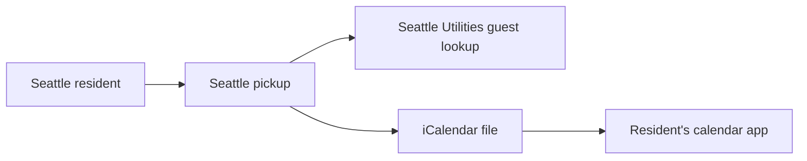
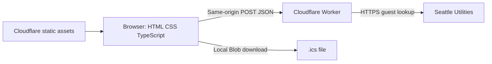
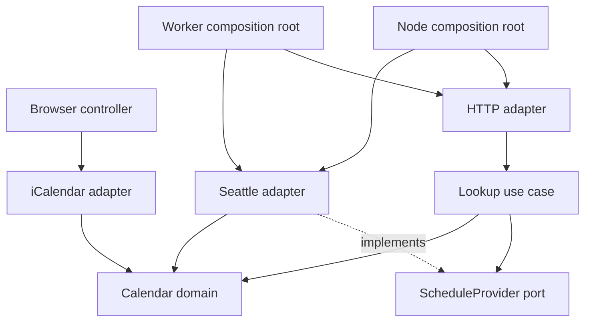
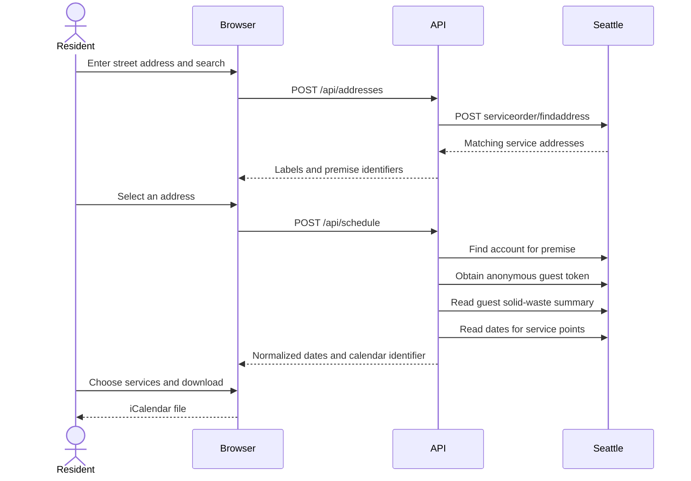

# Architecture

Seattle pickup converts SPU’s address-specific collection dates into a downloadable calendar. A resident searches for an address, selects the correct service location, and chooses which collection services to export. The app stores no address book or subscription state.

## System context

The city remains the source of collection dates. Importing a file does not establish an ongoing connection between the calendar app and SPU.

## Containers

For local development, Vite and a Node.js HTTP server replace the CDN and Worker. The calendar file is generated in the browser; addresses and account details are not embedded in it. There is no persistent application datastore.

## Components and dependencies

- **Domain:** collection types, dates, deduplication, ordering, and domain errors. No platform or networking dependencies.
- **Application:** input validation and lookup orchestration; depends on a `ScheduleProvider` port. Filters past collections using the Seattle date at fetch time.
- **Driven adapter:** `SeattleProvider` validates upstream data with Zod and maps it into domain values. It receives injectable `fetch` and clock functions.
- **Driving adapters:** HTTP requests and browser interactions invoke application behavior. Node and Worker entry points provide runtime wiring.
- **Output adapter:** `IcalWriter` implements `CalendarWriter`, preserving date-only semantics and RFC 5545 text escaping, UTF-8 line folding, and CRLF endings.

An ESLint dependency rule prevents domain imports from application, adapters, or Node built-ins. Ports use small interfaces; no dependency injection container is needed.

## Lookup sequence

Guest tokens and account identifiers remain in the server request’s memory. The browser receives only address candidates and normalized schedule data. API responses use `Cache-Control: no-store`; input bodies are bounded to 2 KiB and upstream calls have 12-second timeouts. There are no automatic retries that multiply traffic during an outage.

## Calendar identity and dates

The calendar identifier is a SHA-256 digest of the selected premise identifier. Event UIDs combine that digest, collection date, and service. Changing the download timestamp does not change event identity. A changed collection date produces a new event; imports cannot remove previously imported dates, which is why the UI recommends a separate calendar.

Each event is all-day, with an exclusive next-day `DTEND`. Calendar dates are validated and manipulated in UTC as date-only values; no daylight-saving conversion shifts a pickup day. No address or resident name appears in events.

## Operational boundaries

The Worker adds approximate per-location IP rate limiting. Static pages bypass Worker execution. Both adapters use the same HTTP contract, so a future Netlify Function can wrap the handler without changing domain code. A production browser scraper would be a new driven adapter and would require a separate hosting decision.
